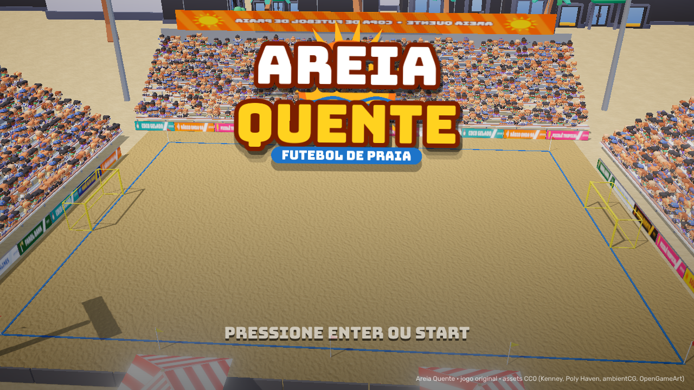
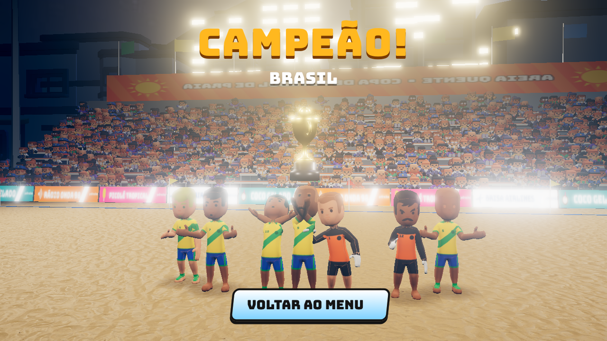

# REI DA PRAIA — Futebol de Praia

Futebol de praia arcade 3D, 5 contra 5, feito em **Three.js + TypeScript** a partir do `PROMPT_MESTRE.md`.
Jogadas de efeito (chapéu, bicicleta, tesoura, voleio, peixinho) geram **pontos de estilo** que enchem o
**brasão-medidor** do placar (azul → dourado); cheio, o time entra no **Modo Fogo** (aura azul, chute com rastro de chamas).

| | |
|---|---|
|  |  |
|  |  |
|  |  |

Todas as capturas estão em [`docs/screenshots/`](docs/screenshots).

## Jogar online

**https://jaapa07.github.io/beach_soccer/** — publicado pelo GitHub Actions (`.github/workflows/deploy.yml`) a cada push na `main`.

O jogo tem **duas versões**, com configurações salvas separadamente:

| Versão | Link direto | Como joga | Padrões |
|---|---|---|---|
| **PC** | https://jaapa07.github.io/beach_soccer/pc.html | teclado ou controle (até 2 jogadores locais), teclas remapeáveis | gráfico alto, 3 min por período |
| **Celular** (iPhone/Android) | https://jaapa07.github.io/beach_soccer/celular.html | joystick e botões na tela, multitoque | gráfico médio (sombras leves), 2 min por período, tamanho dos botões e vibração nas Opções |

O link principal escolhe sozinho (tela de toque → Celular). Dá para trocar em *Opções → Versão do jogo*
ou com `?plataforma=pc` / `?plataforma=celular`.
Para ativar (uma única vez): no repositório, *Settings → Pages → Build and deployment → Source: **GitHub Actions***.

## Como rodar

```bash
npm install
```

```bash
npm run dev
```

Abra o endereço que o Vite mostrar. Para gerar a versão de produção em `dist/`:

```bash
npm run build
```

`?stats` na URL mostra o painel de FPS (stats.js).

## Controles

| Ação | Teclado | Controle (Xbox) |
|---|---|---|
| Mover | WASD / setas | analógico esquerdo / direcional |
| Passe rasteiro · trocar jogador na defesa | J | A |
| Chute (segure para mais força) | K | B |
| Lençol / passe pelo alto (no treino, sem bola: cruzamento) | L | X |
| Firula: embaixadinha, chapéu (com adversário à frente), matar no peito | I | Y |
| Correr | Shift | RT |
| Carrinho / dividida | Espaço | LT |
| Modo Fogo (brasão dourado) | E | RB |
| Pausa · pular cinemáticas/replays | Esc / Enter | Start |

Finalizações são contextuais: com a bola no alto, **K** vira cabeçada (bola alta), **bicicleta** (de costas para o gol),
**tesoura** (gol de lado), **voleio** ou **peixinho** (correndo para uma bola baixa). As teclas podem ser remapeadas em *Opções*.
Na tela "Quem joga com quem?" cada teclado/controle é movido para CASA, CPU ou FORA (até 2 jogadores locais).

### iPhone / Android (tela de toque)

Abra o link no Safari **com o aparelho deitado**. Para tela cheia (sem a barra do Safari): botão Compartilhar → **Adicionar à Tela de Início**
e abra pelo ícone.

| Na tela | Faz |
|---|---|
| Joystick (toque em qualquer ponto da metade esquerda) | mover · empurrar até a borda = correr |
| CHUTE (segure para mais força) · PASSE/TROCAR · LENÇOL · FIRULA · CARRINHO · CORRER · FOGO | as mesmas ações do teclado |
| ❚❚ (canto superior) | pausa |
| PULAR ▶▶ | pula apresentação, replay e intervalo |

Só **3 botões grandes**, que mudam conforme o lance (um selo mostra o modo):

| Modo | Quando | Botões |
|---|---|---|
| **ATAQUE** | você está com a bola | **CHUTE** (grande; goleiro: LANÇAR), **PASSE**, **LENÇOL** |
| **APOIO** | um companheiro da CPU está com a bola | CHUTE de primeira, **PEDIR**, **PEDIR ALTO** |
| **DEFESA** | o adversário está com a bola / bola dividida | **CARRINHO** (grande), **TROCAR**, **MARCAR** (segure: corre sozinho e dá o bote) |

- **Correr:** empurre o joystick até a borda.
- **Chapéu / firula:** segure CHUTE e toque PASSE.
- **FOGO:** aparece no topo da tela quando a barra de estilo enche.
- Botão que não pode agir no lance fica apagado; o toque entre dois botões aciona o mais próximo.

### Jogabilidade (passe, chute, defesa)

- **Passe no pé (estilo PES/FIFA):** apontando mais ou menos para um companheiro ele é o escolhido; quem recebe para e espera
  (mesmo com o dedo no joystick), a bola corrige a rota até o pé dele e sai picada se houver marcador no caminho.
- **Passe com alvo visível:** enquanto você conduz, um anel verde "PASSE" marca quem vai receber. Com o direcional apontado o passe
  segue a direção; solto, vai para o companheiro mais livre e mais à frente (o rasteiro evita linhas com adversário no caminho).
- **Passe calculado para a areia:** a força do passe rasteiro é calculada pelo atrito da areia para a bola chegar viva no companheiro,
  mirando onde ele vai estar. O recebedor vai ao encontro da bola e domina com mais facilidade.
- **Pedir a bola:** J (ou PEDIR) sem a bola com um companheiro da CPU nela faz ele passar para você; L (PEDIR ALTO) pede pelo alto.
- **Chute:** toque rápido já sai com força boa; segurar carrega até a força máxima (barra embaixo do jogador).
- **Troca automática** (Opções): na defesa, o controle passa sozinho para o companheiro bem mais perto da bola.

## O que tem

- **Telas**: abertura com barra de progresso real → título com sobrevoo da arena → menu → seleção de controles → seleção de seleções
  (8 times, uniforme 1/2, arena, modelo 3D girando) → carregamento com herói 3D e dicas → apresentação cinematográfica
  (sobrevoo, aquecimento com nome na tela, times perfilados) → partida → intervalo com dançarinas e estatísticas → replay de gol
  (3 ângulos, câmera lenta, rastro) → resultado com craque da partida → Copa (mata-mata de 8, salva no navegador) → troféu.
  Mais Treino (3 desafios), Opções (volumes, duração, dificuldade, qualidade, remapeamento) e Créditos.
- **Modo Carreira**: temporadas com liga de pontos corridos (8 seleções, 7 rodadas, vitória no tempo normal = 3 pts, na prorrogação/pênaltis = 2),
  semifinal e final, pontos de evolução para melhorar o elenco, metas da diretoria, reputação, convites de outras seleções e histórico de títulos.
- **16 seleções** (Brasil, Argentina, Portugal, Espanha, Itália, França, Japão, Senegal, Uruguai, Paraguai, México, Taiti, Irã, Suíça, EUA e Egito),
  todas com jogadores fictícios, uniformes casa/fora/goleiro, bandeira e brasão.
- **Desafios da Praia** (minijogos com recorde e 1–3 estrelas): **Pênaltis de Ouro** (5 cobranças contra um goleiro cada vez melhor),
  **Embaixadinhas** (aperte [I] no tempo certo; "PERFEITO" vale bônus) e **Tiro ao Alvo** (10 bolas, alvos nos cantos e um alvo móvel).
- **18 conquistas** com avisos na tela, estatísticas de carreira e **4 bolas desbloqueáveis** (Clássica, Dourada, Neon, Retrô).
- **Partida**: 3 períodos (duração real configurável: 2/3/5 min), sem impedimento, laterais com a mão, faltas por carrinho,
  cartões (2 amarelos = 2 minutos fora), tiro livre direto sem barreira, pênalti na área, escanteio, bola do goleiro,
  prorrogação com gol de ouro e disputa de pênaltis (3 cobranças + alternadas), substituições e 3 formações.
- **IA** por estilo de seleção (o Brasil abusa das firulas, a Itália fecha a casinha), com pressão, marcação, apoio,
  finalizações acrobáticas e goleiro que mergulha, encaixa ou espalma.
- **Visual**: personagens animados com uniformes pintados por jogador (número e nome nas costas, pés descalços, tornozeleira),
  areia PBR com pegadas e poeira, torcida instanciada que pula conforme a emoção, redes que balançam, bandeiras ao vento,
  mar animado, céu HDRI, holofotes com bloom à noite, confete, rastro e explosão no Modo Fogo, sombra de contato.
- **Áudio**: 5 músicas CC0, torcida (ambiente, "uuuh", explosão de gol), ondas e gaivotas, chutes, quiques, trave, rede, apitos.

## Animações

A locomoção e os gestos principais usam **captura de movimento livre**, convertida para o rig do jogo por
`scripts/blender/retarget.py`: Quaternius *Universal Animation Library* (CC0) para parado, caminhada, trote, corrida, sprint,
dança, conversa e queda; CMU Motion Capture Database (uso livre) para **chutes reais de futebol**, passe, lançamento, arremesso,
estrela, polichinelo, aceno e alongamento. Movimentos que não existem nessas bibliotecas (bicicleta, tesoura, peixinho,
mergulhos do goleiro, carrinho, árbitro) continuam como clipes autorais.

## Estrutura

```
src/
  core/    Assets (carregador com progresso), Audio (Howler), Input (teclado + Gamepad API), Save, Strings
  game/    World (cena, arena, céu, luzes, torcida, água, redes, pós-processamento), Athlete (personagem animado)
  match/   Match (regras, controle, chutes, estilo, bolas paradas, períodos, pênaltis), AI, Ball, Player, Team, Camera, Replay
  vfx/     Effects (partículas em flipbook, pegadas, rastro)
  ui/      Flow (todas as telas), Hud
  data/    teams, arenas, moves, clips, strings.pt-BR, credits
scripts/   pipeline de assets (Node + Python + Blender headless) e testes Playwright
public/assets/  modelos .glb, texturas, sprites, UI, áudio (inventário completo em ASSETS.md)
```

## Pipeline de assets

Os assets em `public/assets/` já estão versionados. Para regenerá-los do zero:

```bash
node scripts/fetch-assets.mjs
```

```bash
BLENDER_PY=/caminho/do/python3.11-com-bpy python3 scripts/build_all.py
```

`fetch-assets.mjs` baixa os pacotes CC0 (Kenney, ambientCG, Poly Haven, OpenGameArt) para `.cache/src`.
`build_all.py` usa o Blender como módulo Python (`pip install bpy` em Python 3.11) para: animar o rig do Kenney com 50 clipes
autorais (`scripts/blender/anims.py`), refazer o UV e exportar `athlete.glb`; montar as 3 arenas; modelar bola, troféu e cone;
congelar a torcida em poses. Os uniformes (166 texturas), placas de patrocinadores fictícios, logo, brasões, bandeiras,
flipbooks e o áudio são gerados por scripts Python. `scripts/build_credits.py` reescreve o `ASSETS.md`.

## QA ponta a ponta

```bash
npm run build && node scripts/qa/run.cjs
```

15 suítes no Chromium headless com um monitor de invariantes injetado no jogo (posições válidas, bola perto do dono,
controle duplicado, estados presos, bola morta): navegação de todos os menus pelo teclado, opções persistidas e
remapeamento, partida completa CPU × CPU, partida jogada por um bot no teclado, 2 jogadores com gamepads simulados,
bolas paradas, faltas/cartões/expulsão, pausa (táticas, substituição, reiniciar), Copa inteira com recarga da página,
pênaltis, treino, os 3 minijogos, conquistas e bolas, vazamento de memória entre partidas e tela de celular.
Resultado em [`docs/QA.md`](docs/QA.md).

Auditoria de telas no celular (todos os botões visíveis em 6 tamanhos de iPhone, inclusive com a barra do Safari):

```bash
node scripts/qa/telas.cjs
```

## Testes

```bash
npm test
```

Testes de lógica (física da bola na areia, gol × travessão, balística, integridade de times/animações/arenas/dicas).

```bash
npm run build && node scripts/screenshots.cjs
```

Percorre todas as telas no Chromium headless e salva `docs/screenshots/`. Outros testes de fumaça:
`node scripts/simtest.cjs 150` (partida CPU × CPU acelerada, falha se houver erro de página) e
`node scripts/inputtest.cjs` (navega pelos menus e joga usando o teclado de verdade).

## Desempenho

O jogo foi desenvolvido e verificado num ambiente sem GPU (Chromium headless com SwiftShader, renderização por software),
onde roda a poucos quadros por segundo — por isso **não foi possível medir os 60 fps** exigidos em 1080p.
Para medir numa máquina real, use `?stats`. Se faltar desempenho, *Opções → Qualidade gráfica → Baixa* desliga sombras e bloom
e reduz a torcida para 55 % dos assentos.

## Licenças e créditos

Todos os assets são CC0 ou criados para o jogo — veja [`ASSETS.md`](ASSETS.md). Fontes Bungee e Rubik (SIL OFL).
Jogadores, apelidos, brasões e patrocinadores são fictícios; nenhuma marca real é usada.

## Limitações conhecidas

- Personagens do Kenney têm "sapatos" na malha; os pés são pintados como pele (descalços) com tornozeleira.
- Locutor: não havia voz CC0 em português; a narração é feita pela torcida e por textos na tela.
- Prorrogação usa gol de ouro (regra arcade).
- Bicicleta, tesoura, peixinho, goleiro e árbitro ainda são animações autorais (não há captura livre desses gestos).
