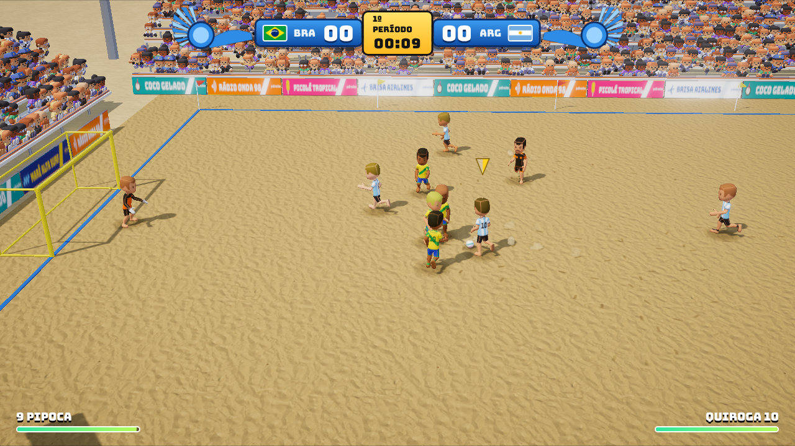
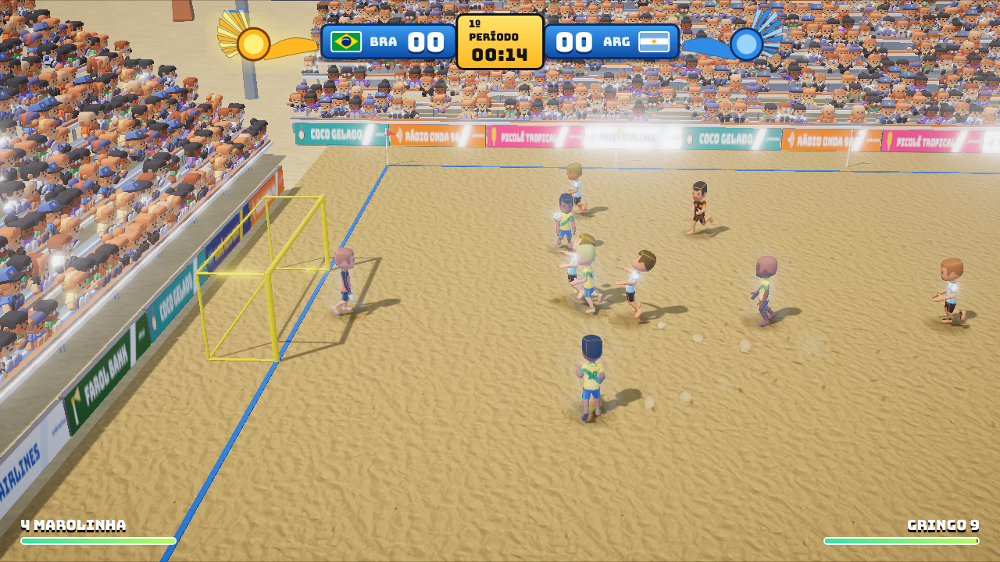
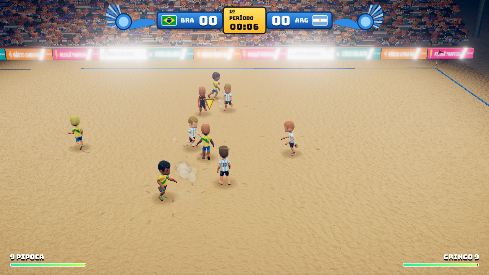
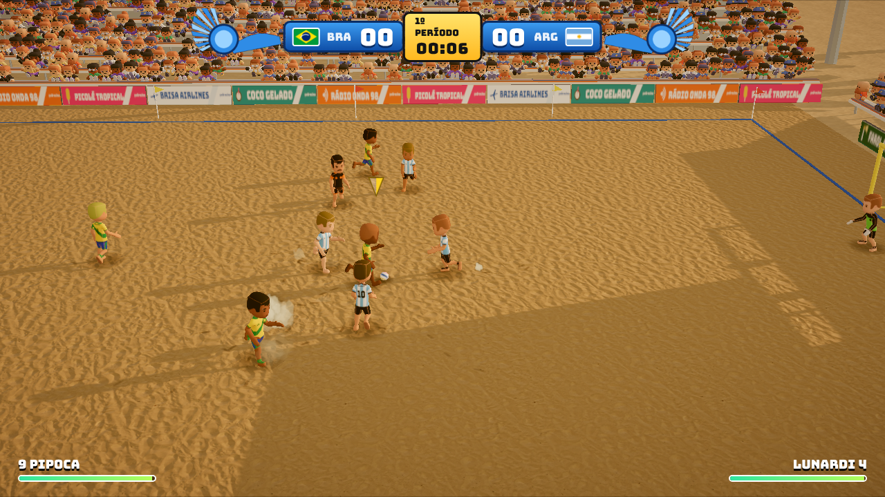

# AREIA QUENTE — Futebol de Praia

Futebol de praia arcade 3D, 5 contra 5, feito em **Three.js + TypeScript** a partir do `PROMPT_MESTRE.md`.
Jogadas de efeito (chapéu, bicicleta, tesoura, voleio, peixinho) geram **pontos de estilo** que enchem o
**brasão-medidor** do placar (azul → dourado); cheio, o time entra no **Modo Fogo** (aura azul, chute com rastro de chamas).

| | |
|---|---|
|  |  |
|  |  |
|  |  |

Todas as capturas estão em [`docs/screenshots/`](docs/screenshots).

## Como rodar

```bash
npm install
```

```bash
npm run dev
```

Abra o endereço que o Vite mostrar. Para gerar a versão de produção em `dist/`:

```bash
npm run build
```

`?stats` na URL mostra o painel de FPS (stats.js).

## Controles

| Ação | Teclado | Controle (Xbox) |
|---|---|---|
| Mover | WASD / setas | analógico esquerdo / direcional |
| Passe rasteiro · trocar jogador na defesa | J | A |
| Chute (segure para mais força) | K | B |
| Lençol / passe pelo alto (no treino, sem bola: cruzamento) | L | X |
| Firula: embaixadinha, chapéu (com adversário à frente), matar no peito | I | Y |
| Correr | Shift | RT |
| Carrinho / dividida | Espaço | LT |
| Modo Fogo (brasão dourado) | E | RB |
| Pausa · pular cinemáticas/replays | Esc / Enter | Start |

Finalizações são contextuais: com a bola no alto, **K** vira cabeçada (bola alta), **bicicleta** (de costas para o gol),
**tesoura** (gol de lado), **voleio** ou **peixinho** (correndo para uma bola baixa). As teclas podem ser remapeadas em *Opções*.
Na tela "Quem joga com quem?" cada teclado/controle é movido para CASA, CPU ou FORA (até 2 jogadores locais).

## O que tem

- **Telas**: abertura com barra de progresso real → título com sobrevoo da arena → menu → seleção de controles → seleção de seleções
  (8 times, uniforme 1/2, arena, modelo 3D girando) → carregamento com herói 3D e dicas → apresentação cinematográfica
  (sobrevoo, aquecimento com nome na tela, times perfilados) → partida → intervalo com dançarinas e estatísticas → replay de gol
  (3 ângulos, câmera lenta, rastro) → resultado com craque da partida → Copa (mata-mata de 8, salva no navegador) → troféu.
  Mais Treino (3 desafios), Opções (volumes, duração, dificuldade, qualidade, remapeamento) e Créditos.
- **Partida**: 3 períodos (duração real configurável: 2/3/5 min), sem impedimento, laterais com a mão, faltas por carrinho,
  cartões (2 amarelos = 2 minutos fora), tiro livre direto sem barreira, pênalti na área, escanteio, bola do goleiro,
  prorrogação com gol de ouro e disputa de pênaltis (3 cobranças + alternadas), substituições e 3 formações.
- **IA** por estilo de seleção (o Brasil abusa das firulas, a Itália fecha a casinha), com pressão, marcação, apoio,
  finalizações acrobáticas e goleiro que mergulha, encaixa ou espalma.
- **Visual**: personagens animados com uniformes pintados por jogador (número e nome nas costas, pés descalços, tornozeleira),
  areia PBR com pegadas e poeira, torcida instanciada que pula conforme a emoção, redes que balançam, bandeiras ao vento,
  mar animado, céu HDRI, holofotes com bloom à noite, confete, rastro e explosão no Modo Fogo, sombra de contato.
- **Áudio**: 5 músicas CC0, torcida (ambiente, "uuuh", explosão de gol), ondas e gaivotas, chutes, quiques, trave, rede, apitos.

## Estrutura

```
src/
  core/    Assets (carregador com progresso), Audio (Howler), Input (teclado + Gamepad API), Save, Strings
  game/    World (cena, arena, céu, luzes, torcida, água, redes, pós-processamento), Athlete (personagem animado)
  match/   Match (regras, controle, chutes, estilo, bolas paradas, períodos, pênaltis), AI, Ball, Player, Team, Camera, Replay
  vfx/     Effects (partículas em flipbook, pegadas, rastro)
  ui/      Flow (todas as telas), Hud
  data/    teams, arenas, moves, clips, strings.pt-BR, credits
scripts/   pipeline de assets (Node + Python + Blender headless) e testes Playwright
public/assets/  modelos .glb, texturas, sprites, UI, áudio (inventário completo em ASSETS.md)
```

## Pipeline de assets

Os assets em `public/assets/` já estão versionados. Para regenerá-los do zero:

```bash
node scripts/fetch-assets.mjs
```

```bash
BLENDER_PY=/caminho/do/python3.11-com-bpy python3 scripts/build_all.py
```

`fetch-assets.mjs` baixa os pacotes CC0 (Kenney, ambientCG, Poly Haven, OpenGameArt) para `.cache/src`.
`build_all.py` usa o Blender como módulo Python (`pip install bpy` em Python 3.11) para: animar o rig do Kenney com 50 clipes
autorais (`scripts/blender/anims.py`), refazer o UV e exportar `athlete.glb`; montar as 3 arenas; modelar bola, troféu e cone;
congelar a torcida em poses. Os uniformes (166 texturas), placas de patrocinadores fictícios, logo, brasões, bandeiras,
flipbooks e o áudio são gerados por scripts Python. `scripts/build_credits.py` reescreve o `ASSETS.md`.

## Testes

```bash
npm test
```

Testes de lógica (física da bola na areia, gol × travessão, balística, integridade de times/animações/arenas/dicas).

```bash
npm run build && node scripts/screenshots.cjs
```

Percorre todas as telas no Chromium headless e salva `docs/screenshots/`. Outros testes de fumaça:
`node scripts/simtest.cjs 150` (partida CPU × CPU acelerada, falha se houver erro de página) e
`node scripts/inputtest.cjs` (navega pelos menus e joga usando o teclado de verdade).

## Desempenho

O jogo foi desenvolvido e verificado num ambiente sem GPU (Chromium headless com SwiftShader, renderização por software),
onde roda a poucos quadros por segundo — por isso **não foi possível medir os 60 fps** exigidos em 1080p.
Para medir numa máquina real, use `?stats`. Se faltar desempenho, *Opções → Qualidade gráfica → Baixa* desliga sombras e bloom
e reduz a torcida para 55 % dos assentos.

## Licenças e créditos

Todos os assets são CC0 ou criados para o jogo — veja [`ASSETS.md`](ASSETS.md). Fontes Bungee e Rubik (SIL OFL).
Jogadores, apelidos, brasões e patrocinadores são fictícios; nenhuma marca real é usada.

## Limitações conhecidas

- Personagens do Kenney têm "sapatos" na malha; os pés são pintados como pele (descalços) com tornozeleira.
- Locutor: não havia voz CC0 em português; a narração é feita pela torcida e por textos na tela.
- Prorrogação usa gol de ouro (regra arcade).
- Clipes de animação são autorais e feitos por keyframes em script — funcionam bem no ritmo do jogo, mas não têm a
  sutileza de captura de movimento.
